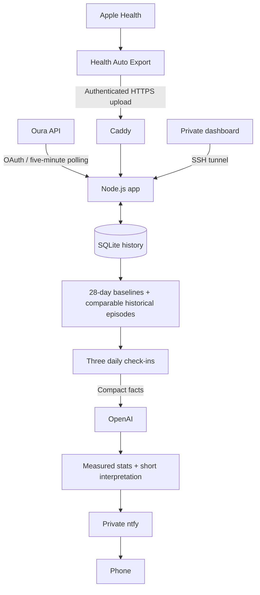

# healf

Personal recovery context, delivered three times a day. healf combines Oura measurements and Apple Health workouts with your own history, then sends short AI-assisted summaries to your phone through ntfy.

### Demo

[](https://github.com/celyna/healf/blob/main/docs/media/healf-demo.mp4)

[Watch the demo](https://github.com/celyna/healf/blob/main/docs/media/healf-demo.mp4) · 15 seconds · synthetic health data

### Why we built this

Health apps show scores, but a score alone rarely explains what to do next. healf connects today's recovery to comparable past days: what you did, how you slept, and what happened afterward. Recommendations should explain their evidence instead of repeating “sleep early” or “take it easy.” Historical associations are context, not proof of cause or medical advice.

### Architecture



- **Morning:** after today's sleep score arrives, before 1 pm; recovery and a grounded suggestion for today.
- **Afternoon:** 1 pm; activity progress and worthwhile adjustments.
- **Evening:** 10 pm; recap and historical context for tonight.

Times use `LLM_TIMEZONE`, including daylight saving. They do not follow phone travel automatically. Five-minute syncs and workout uploads are silent. Missed check-in windows are skipped; restarting within a window can catch up once. Failed AI attempts consume their slot; notification retries reuse the result. Delivery retries can occasionally duplicate a notification.

### Setup

You need Docker Compose on an always-on host, an Oura OAuth application, an OpenAI API key with billing enabled, and an ntfy server/topic with access restricted to you.

#### 1. Configure the app

```sh
cd oura-ntfy
docker network create oura-notifications # once; skip if it already exists
docker run --rm --user "$(id -u):$(id -g)" -v "$PWD:/setup" -w /setup node:24-alpine node setup.mjs
```

Edit the generated `.env` privately:

| Setting | Purpose |
| --- | --- |
| `OURA_CLIENT_ID`, `OURA_CLIENT_SECRET` | Your Oura application's credentials |
| `BASE_URL` | `http://localhost:3000` for the SSH-tunnel setup |
| `NTFY_SERVER`, `NTFY_TOPIC`, `NTFY_TOKEN` | HTTPS server, protected topic, publishing token |
| `LLM_ENABLED`, `OPENAI_API_KEY` | Set `true` and provide your API key |
| `OPENAI_MODEL` | Defaults to `gpt-5-mini` |
| `LLM_TIMEZONE` | Your IANA timezone, e.g. `America/Los_Angeles` |
| `SLEEP_CHRONOTYPE`, `SLEEP_TARGET_*` | Optional personal Body Clock profile; see `.env.example` |

Keep the generated `ADMIN_PASSWORD`, `ENCRYPTION_KEY`, and webhook verification secret. Set all three optional sleep target times together as `HH:MM`, with `SLEEP_TARGET_TIMEZONE`. No personal target is built into the code.

**Current limitation:** scheduled check-ins require enabled OpenAI analysis. Disabling it or enabling `PRIVATE_NOTIFICATIONS` stops automatic check-ins; a standalone metrics-only schedule is not implemented.

#### 2. Start and connect

Register `http://localhost:3000/oauth/callback` as the exact redirect URI in your Oura application. Then:

```sh
docker compose up -d --build
# On your computer, for a remote server; leave this running:
ssh -N -L 3000:127.0.0.1:3000 your-user@your-server
```

Open **http://localhost:3000**, sign in as `admin` using `ADMIN_PASSWORD`, and select **Connect Oura**. Use this exact hostname for form submissions. Sync your ring in Oura, then use **Send test notification** to verify phone delivery; that button does not generate a new AI analysis.

The app binds host port 3000 to loopback. Closing the tunnel only closes dashboard access; the server continues running. Polling needs no public app endpoint. Optional Oura webhooks are disabled by default.

#### 3. Optional Apple Health workouts

Use Health Auto Export with REST API support. Configure public HTTPS ingress using [`public-info/Caddyfile`](public-info/Caddyfile), replacing the example domains. The proxy must join `oura-notifications`, mount the Caddyfile and static files, expose ports 80/443, and persist its certificate data. It exposes `/import/apple-health` while keeping the dashboard private. Do not start two Caddy instances on the same ports; the app's optional HTTPS profile is an alternative layout.

In Health Auto Export:

- REST endpoint: `https://YOUR-IMPORT-HOST/import/apple-health`.
- Header: `Authorization: Bearer YOUR-UPLOAD-TOKEN`, copied from the private dashboard.
- Workouts, JSON version 2, workout metrics **on**, minute grouping, routes **off**.
- Routine range **Default** (yesterday + today); use **Manual Export** for historical backfill.

HTTP 200 with `accepted` confirms ingestion; 401 means a token problem, 400 invalid payload, and 415 wrong content type. Keep requests below 10 MB and 500 workouts. iOS controls background execution, so sync timing is not guaranteed. Repeated IDs update records; Apple Health deletions do not propagate.

For self-hosted ntfy, [`private-ntfy/`](private-ntfy/) contains Compose/configuration helpers. Set your domain in `server.yml`, start that stack, and run `configure.py` on the server with `NTFY_SERVER=https://YOUR-NTFY-HOST`; it creates read-only phone access and write-only publishing credentials. Its paths assume `/opt/private-ntfy` and `/opt/oura-ntfy`. Put the files there first. iPhone wake notifications use the configured ntfy upstream; verify actual delivery on your phone.

### How personal context works

- **Baselines:** preceding 28 calendar days, excluding the day being evaluated; at least seven measured days per metric.
- **Historical episodes:** searches 180 days for matching workout activity mixes/counts, durations within 30%, and distances within 30% when known. Recovery-state matches require at least two comparable baseline-relative metrics.
- **Outcomes:** up to three subsequent historical days, with recorded activity and recovery. Each episode uses its own prior baseline. Current/future outcome dates are excluded.
- **Interpretation:** morning and evening receive up to three matches per retrieval category. One example is not a pattern; missing workouts are not proof of rest. This is deterministic retrieval, not an embedding/vector database.
- **Sources:** daily steps/calories come from Oura. Apple workouts are preferred over matching Oura workouts by activity and start/end times within two minutes; deduplication is heuristic.
- **Sleep timing:** compares the recorded bed interval with a manually supplied target. It does not determine completed sleep cycles, exact wake stage, or a guaranteed cycle-end alarm time. No “strain” measurement is invented.

### Privacy and operation

SQLite persists in the `oura-data` Docker volume. Normalized Oura records, supported Apple HR/speed/power/cadence samples, cached analysis and operational state remain until removed. Analysis windows are not retention limits. OAuth tokens are encrypted with the key in `.env`; health records and the upload token are not application-encrypted.

OpenAI receives selected metrics, baselines, compact workout summaries, historical examples, and configured personal context—not full sample arrays, GPS routes or authentication secrets. `store:false` is requested; provider retention policies still apply. ntfy notifications are not end-to-end encrypted and may appear on the lock screen.

Never commit `.env`, databases, credentials, personal deployment files or backups. Back up `.env` and the data volume together with the app stopped. Losing the encryption key makes saved OAuth tokens unreadable. The sample public privacy/terms pages describe a personal deployment; review them before hosting.

```sh
# From oura-ntfy/
docker compose ps
docker compose logs --tail 50 app
docker compose up -d --build # after code/config changes
```

The status page reports sync/AI/delivery errors. `/healthz` checks process liveness, not data freshness or phone receipt. Revoke Oura access and stop the service to disconnect; deleting the data volume removes stored history irreversibly.

### Development

Node.js 24+, built-in HTTP/crypto/SQLite APIs, no npm dependencies:

```sh
cd oura-ntfy
npm test
npm run setup # first time only
npm start
```

Core modules live in `oura-ntfy/src`: `core.mjs` handles sync/storage/scheduling; `apple-health.mjs` and `workout-performance.mjs` normalize workouts; `recovery-history.mjs` retrieves comparable episodes; `analysis-context.mjs`, `llm.mjs`, and `notification.mjs` prepare and present the analysis. Tests cover authorization, imports, deduplication, scheduling, baselines and history matching using synthetic data.
